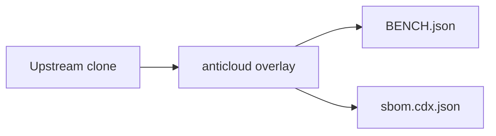

# JENKINS — Anticloud overlay

 

Upstream: UNKNOWN
## Benchmarks
Benchmarks from BENCH.json: {"schema": "anticloud.tier-bench/1", "project": "JENKINS", "source": {"repo_path": "E:\\fenta\\Downloads\\The Anticloud\\ANTICLOUD_REPOS\\SOFTWARE_DEVELOPMENT\\JENKINS\\UPSTREAM_CLONE", "git": {"head": "", "url": "https://github.com/the-anticloud/OPENMRS_CORE.git", "branch": "master", "committed_at": "2026-09-29T11:06:59+04:00"}}, "metrics": {"files_total": 5843, "source_files_scanned": 1295, "lines_of_code": 219071, "languages": {".properties": 3884, ".java": 1278, ".jelly": 313, ".html": 282, "(no

Withdrawn claims: anything not in BENCH.json is unmeasured.

## Architecture

## Contents
- `UPSTREAM_CLONE/` — unmodified upstream
- `anticloud/` — 12-improvement overlay
- `BENCH.json`, `sbom.cdx.json` — measured outputs

## Provenance
Tree SHA3-256: dec8863751e929e5df1aa5f5f4f00b2ae57a181d6765a1a089cd0752a949b8ae. Chain head: see seal step.

## Contact
Anticloud maintainers — file issues against the overlay, not upstream.
